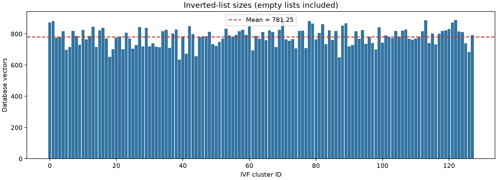
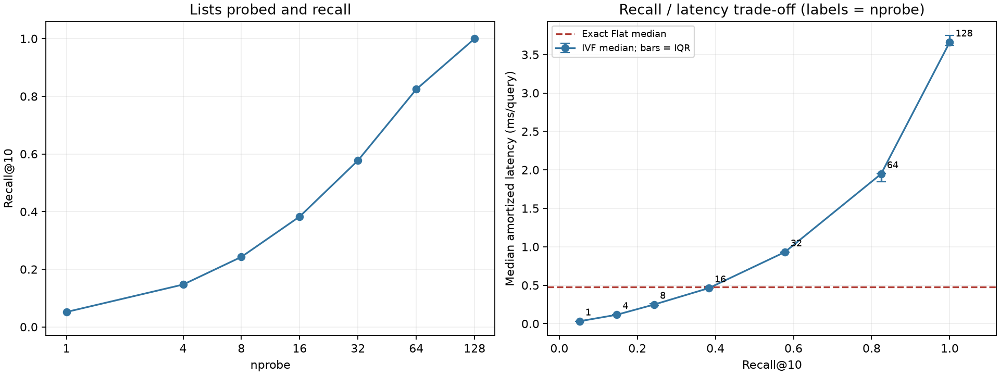

# Repeated CPU evaluation and IVF workload analysis

`benchmark.py` extends the existing application with experimental evaluation.
It imports dataset preparation, index construction, FAISS search, cluster
inspection, Recall@k, and array export from `ivf_flat.py`; it does not replace
the original CLI. FAISS still performs all clustering and nearest-neighbor work.

All scientific parameters remain configurable. `python benchmark.py --help`
lists the options, `--config` layers a custom JSON object over the large defaults,
and explicit CLI arguments take precedence. For example:

```sh
python benchmark.py --threads 2 --repeats 7 --output-dir results/large_threads2
python benchmark.py --nb 2000 --dim 16 --nq 20 --nlist 8 \
  --nprobe 1 2 4 8 --k 5 --output-dir results/benchmark_smoke
```

The driver requires at least one warmup and five measured repetitions. Use
`--no-plots` to skip figures or `--examples 1` to print one example query's
neighbors (default: aggregate tables only). Dataset generation/loading and
training-file/subset controls retain the baseline CLI's semantics. For loaded
data with a different dimension, override the large preset's `--dim` too.

## Reproduce the larger experiment

From the repository root (Linux with Python 3.12):

```sh
cd ann/faiss_cpu
. .venv/bin/activate
python -m pip install -r benchmark-requirements-lock.txt
python -m unittest discover -s tests -v
python -u benchmark.py --config configs/large.json
```

Create the virtual environment first with `python3 -m venv .venv` if needed.
`benchmark-requirements.txt` supplies version ranges; the benchmark lock file
records the complete environment used in the VM, including Matplotlib and
threadpoolctl. The original core requirements files are unchanged. Matplotlib
uses a headless backend; a desktop or GUI is not required.

`configs/large.json` specifies 100,000 database vectors, 128 dimensions, 1,000
independent queries, 128 lists, `k=10`, probes 1/4/8/16/32/64/128, seed 42, one
thread, two warmup searches per case, and five measured repetitions per case.
Training input is the database; FAISS may sample it according to its own
`max_points_per_centroid` setting, recorded in `summary.json`.

Every parameter can be overridden on the command line, for example:

```sh
python benchmark.py --config configs/large.json --threads 2 --repeats 7 \
  --warmup 3 --seed 123 --output-dir results/large_threads2_seed123

python benchmark.py --nb 5000 --dim 32 --nq 50 --nlist 16 \
  --nprobe 1 4 8 16 --k 10 --train-size 4000 --threads 1 \
  --output-dir results/small_benchmark
```

A custom JSON file overrides fields in `configs/large.json`; explicit CLI flags
override JSON defaults. JSON uses CLI destination names such as `output_dir`
and `train_size`, with `nprobe` as a nonempty integer list. File-loading options
from the original CLI also work; provide `--dim` to match loaded data when it
differs from this benchmark's default dimension 128. Keep training and query
vectors separate. At least one warmup and five measured repetitions are enforced
by this driver. Use `--no-plots` to generate the CSVs without figures. The original
CLI retains its existing defaults and permits shorter correctness checks.

## What the search measurements mean

Build/training/insertion times are separate from search. Each case first receives
its configured number of full-batch warmup searches. Every measured round then
contains one Flat search and one search for each requested nprobe. A seed-shuffled
case order reduces fixed-order bias; the actual order and raw timings are saved.
FAISS's OpenMP thread count and loaded BLAS/OpenMP thread pools are limited to
`--threads` consistently for the entire experiment. Effective thread-pool state
and library versions are recorded in `summary.json`.

Each timed call searches the whole query batch using `time.perf_counter()`.
The per-query latency for a repetition is `batch_seconds * 1000 / nq`.
Reports contain its mean, median, minimum, maximum, interquartile range
(`p75 - p25`), and sample standard deviation (`ddof=1`) across measured repetitions.
These are **amortized batch latencies**. They are not isolated-request latency,
per-query timing samples, tail latencies, or confidence intervals. For example,
the workload p95 described below concerns list sizes, not response-time p95.

`qps_from_median = nq / median_batch_seconds` and
`qps_from_mean = nq / mean_batch_seconds`. The table and plot use median latency;
the table's QPS and speedup use the same median basis. Median speedup is
`Flat_median_seconds / IVF_median_seconds`; values above one mean IVF was faster
for this workload. A mean-based speedup is also saved. Recall@k is the original
mean ID-set overlap with the exact Flat top-k results. Ties and floating-point
effects retain the limitations described in the main README.

Timing excludes index construction, workload analysis, recall calculation,
printing, exports, and plotting. The coarse-quantizer search inside the normal
IVF search **is included** in IVF timing; the separate quantizer calls used to
analyze query traffic are excluded. Construction is performed once per run;
repetitions measure repeated search of the same trained index and query batch.

## Cluster distribution and query traffic

Stored inverted-list membership supplies sizes and database row assignments.
The cluster statistics assert that all sizes sum to `index.ntotal`. Minimum,
maximum, mean, population standard deviation (`ddof=0`), empty-cluster count,
and largest/mean ratio include all clusters, including empty ones.

For each query and each probe setting, the trained coarse quantizer's
`search(queries, nprobe)` supplies the selected cluster IDs, ordered by centroid
distance. The analysis counts how many queries select each cluster. All clusters
receive a row, even when traffic is zero. It also sums the sizes of the selected
lists for each query.

**Estimated scan workload** means the total number of database vectors belonging
to the selected lists. It is **not an instrumented FAISS distance-computation
count**. It does not count centroid distance computations, cache activity,
instructions, bytes transferred, or DPU work. Summing this quantity across the
queries counts a vector again whenever its list is selected by another query.
This driver uses the unmodified IVF-Flat search with no scan cap (`max_codes=0`).

Traffic max/mean ratio, population coefficient of variation (`std / mean`),
unselected-list count, and counts of clusters receiving at least twice mean
traffic describe the observed sample. The twice-mean threshold is diagnostic;
it is not a statistical significance test. `query_fraction` is the fraction of
queries selecting a cluster; `selection_share` is its share of all `nq*nprobe`
list selections. Per-cluster `query_count * list_size` estimates aggregate scan
work and exposes how traffic and data-size imbalance can combine.
Traffic describes the query batch once; warmups and repeated timing runs do not
multiply the workload counts.

When all lists are probed, each cluster receives every query, so traffic CV is
zero; differing cluster sizes can still imply differing scan work. These data
can inform later cluster placement studies, but do not predict execution time
for any proposed DPU placement.

## Output files

Use a distinct output directory for each experiment; matching files are
overwritten and unrelated existing files are retained. Default output is
`results/large/`, ignored by Git.

| File | Contents |
| --- | --- |
| `benchmark_results.csv` | Flat and IVF Recall@k, mean/median latency, IQR, sample std, min/max, QPS, mean/median speedup, missing neighbors, and experiment settings |
| `search_repetitions.csv` | One row per timed search, with measured round, shuffled position, case, batch seconds, amortized ms/query and QPS |
| `cluster_statistics.csv` | One row with all cluster-size summary statistics and verified total vector count |
| `cluster_sizes.csv` | Each list's ID, size, database fraction, and size/mean ratio |
| `query_selected_lists.csv` | Each `(nprobe, query_id, centroid_rank, cluster_id, list_size)` selection; IDs start at zero and ranks at one |
| `query_workload.csv` | Each query/setting's estimated scan vectors and database fraction |
| `cluster_query_traffic.csv` | Every cluster/setting's size, query count, fractions, traffic/mean ratio, and aggregate estimated scan vectors |
| `workload_summary.csv` | Per-setting traffic imbalance and estimated per-query scan-work distribution, including mean, median, population std, min, max and p95 |
| `summary.json` | Resolved configuration, effective dataset sizes, environment, build times, index settings, all summaries and measurement definitions |
| `cluster_sizes.png` | List-size bar chart with the mean indicated |
| `recall_latency.png` | Recall versus nprobe and median latency versus recall; nprobe labels, IQR bars, and an exact Flat reference |

The baseline array exports (`base.npy`, `queries.npy`, `training.npy`,
`centroids.npy`, `assignments.npy`, `cluster_sizes.npy`, `exact_results.npz`, and
one `ivf_nprobe_N.npz` per setting) are also retained. Full data stay in memory;
this is not an out-of-core experiment. The benchmark's `summary.json` schema
includes its richer metrics; the original application's summary schema is
unchanged.

## Validation and interpretation limits

With benchmark dependencies installed, the suite contains the original 14 tests
and 12 additional evaluation tests. The new tests check known statistics and
percentiles, sizes summing to the indexed count, zero-size lists, actual FAISS
quantizer selections, estimated workloads against stored vector assignments,
traffic totals, balanced traffic when all lists are selected, invalid inputs,
minimum repetition requirements, CLI overrides, search correctness, speedup
arithmetic, CSV round trips, thread limits, and PNG generation. The original
every-list IVF-versus-Flat correctness test is preserved. With only core
dependencies, the optional benchmark test module is skipped rather than breaking
the baseline suite.

The supplied uniform synthetic data provide a reproducible baseline. Meaningful
ANN conclusions require representative embeddings and query distributions.
Five repetitions give a variability estimate, not a guarantee of stable timing;
OS scheduling, CPU clocks, cache state, BLAS implementation, and VM host load
can affect results. A fixed seed and thread count do not make timing deterministic.

All reported times are **native CPU wall-clock times inside the VM**.
uPIMulator's simulated DPU cycles are a different measurement and cannot be
directly compared to these numbers. This extension adds no DPU code, inter-DPU
communication model, or CPU–DPU speedup claim.

## Actual VM run: 2026-11-20

The documented large configuration completed on the VM with Python 3.12.3,
FAISS CPU 1.16.0 (AVX2), NumPy 2.5.5, and one thread in FAISS and both detected
OpenBLAS pools. The VM exposes two virtual CPUs with an Intel Core i7-4980HQ
model name and 3.8 GiB RAM. There were two warmups per case and five measured
rounds, with all eight cases shuffled within each round using seed 42.

| Index / nprobe | Recall@10 | Mean ms/query | Median ms/query | IQR ms/query | Sample std ms/query | Median QPS | Median speedup vs Flat |
| --- | ---: | ---: | ---: | ---: | ---: | ---: | ---: |
| Flat | 1.0000 | 0.47346 | 0.47685 | 0.02218 | 0.01957 | 2,097.1 | 1.000x |
| IVF / 1 | 0.0519 | 0.03408 | 0.03212 | 0.00159 | 0.00564 | 31,128.7 | 14.844x |
| IVF / 4 | 0.1470 | 0.11472 | 0.11588 | 0.00234 | 0.00474 | 8,629.4 | 4.115x |
| IVF / 8 | 0.2429 | 0.25184 | 0.24907 | 0.02650 | 0.02582 | 4,014.9 | 1.914x |
| IVF / 16 | 0.3829 | 0.46932 | 0.46240 | 0.03197 | 0.01838 | 2,162.6 | 1.031x |
| IVF / 32 | 0.5775 | 0.94062 | 0.93038 | 0.00509 | 0.03585 | 1,074.8 | 0.513x |
| IVF / 64 | 0.8243 | 2.06737 | 1.94720 | 0.11091 | 0.40221 | 513.6 | 0.245x |
| IVF / 128 | 1.0000 | 3.66989 | 3.65959 | 0.12354 | 0.08042 | 273.3 | 0.130x |

IVF training took 0.247899 s and insertion 0.172203 s, measured separately.
Training was supplied all 100,000 database vectors; FAISS's default cap of 256
training points per centroid limits clustering to 32,768 sampled vectors for
128 lists. The cap, iterations, and seed are recorded in `summary.json`.

The 128 list sizes sum to **100,000**: min 635, max 898, mean 781.25,
population std 55.378668, zero empty lists, and largest/mean ratio 1.14944.

| nprobe | Mean estimated scan vectors/query | Traffic CV | Maximum/mean traffic |
| ---: | ---: | ---: | ---: |
| 1 | 787.900 | 0.344 | 2.304 |
| 4 | 3,138.487 | 0.163 | 1.472 |
| 8 | 6,274.211 | 0.133 | 1.344 |
| 16 | 12,550.876 | 0.103 | 1.248 |
| 32 | 25,099.596 | 0.086 | 1.232 |
| 64 | 50,153.099 | 0.061 | 1.116 |
| 128 | 100,000.000 | 0.000 | 1.000 |

At `nprobe=1`, cluster 123 was selected by 18 of 1,000 queries, versus the
all-cluster mean of 7.8125, with a range of 3–18 selections. Only one cluster
exceeded twice mean traffic. This is a descriptive observation from 1,000
synthetic queries, not evidence of a statistically significant hotspot. At full
probing, traffic is equal across all clusters, while list sizes remain unequal.

Low probe counts traded substantial recall loss for reduced search time on
this dataset. `nprobe=16` was approximately at Flat's measured latency while
recovering 38.29% of exact neighbors. Full probing recovered all exact neighbors
but was about 7.67 times slower than Flat in this run. These outcomes apply to
this synthetic dataset, batching, library build, and VM environment; they do
not establish performance on representative embeddings or real hardware DPUs.
In particular, `nprobe=64` had a relatively large sample standard deviation;
the raw timing CSV retains the slow repetition rather than discarding it.

All **26 tests passed**. Additional checks of the actual large-run exports
verified all 253,000 selected-list rows, 7,000 per-query workload rows, 896
cluster-traffic rows, and 40 timing repetitions against their aggregates. The
large-run full-probing IDs also matched exact Flat, with squared distances
matching within floating-point tolerance. The original implementation, tests, and dependency files are included alongside
the benchmark driver.

A compact snapshot of this run is committed in
[`benchmarks/large/`](benchmarks/large/): aggregate CSVs, raw search repetition
timings, a summary, and the two plots. Generated vector/neighbor arrays, detailed
per-query tables, and machine-local files are excluded. Absolute shared-library
paths were removed from the copied summary and CSV line endings were normalized
to LF; scientific settings and measurements are unchanged.





Re-running writes to ignored `results/large/` and leaves the recorded snapshot
intact. Wall-clock timings will naturally differ.
